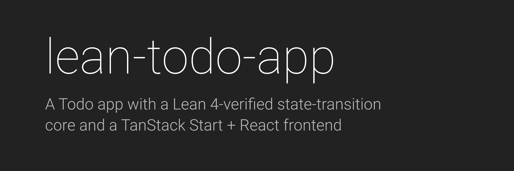
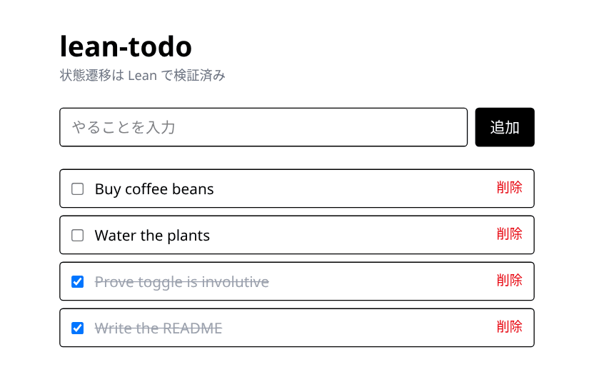

<p align="center"></p>

<p align="center"><strong>A Todo app with a Lean 4-verified state-transition core and a TanStack Start + React frontend</strong></p>

<p align="center"><a href="LICENSE"></a> <a href="https://github.com/conao3/lean-todo-app/stargazers"></a></p>

<p align="center"><a href="#architecture">Architecture</a> | <a href="#proven-properties">Proven properties</a> | <a href="#development-environment">Development environment</a> | <a href="#backend-lean-4">Backend</a> | <a href="#frontend-tanstack-start">Frontend</a></p>

<h1>lean-todo-app</h1>

A Todo app whose state-transition core is **verified in Lean 4**, with a TanStack Start + React frontend.



The screenshot shows the app with sample data.

## Architecture

```
frontend/   TanStack Start + React: UI and HTTP
backend/    Lean 4 (lake): defines the Todo state machine and proves its invariants
```

The Todo list state and each operation (add / toggle / remove) are defined as a state machine in Lean 4, and the property "no operation ever reaches an invalid state" is proved. The Lean core is exposed as a JSON one-shot CLI; a TanStack Start server function spawns it, so only the proven transition function mutates state. The frontend displays state and issues commands.

## Proven properties

The invariant `Valid` says every todo id is `< nextId` and ids are unique (so deleted ids are never reused).

```
-- Safety: every operation preserves the Valid invariant
empty_valid / add_valid / toggle_valid / remove_valid / step_valid

-- Functional correctness
add_length       (l.add title).items.length = l.items.length + 1
toggle_length    toggle preserves the item count
remove_removes   the removed id is gone from the list

-- Algebraic properties
toggle_involutive  toggling the same id twice returns the original list
remove_idempotent  removing twice equals removing once
```

`lake build` succeeding means these hold for all inputs, checked at compile time.

## Development environment

The flake devShell pins lean4 (with lake) and Node.js.

```sh
nix develop
```

With direnv, copy `.envrc.example` to `.envrc`. `devo.yaml` launches backend + frontend together (see `devo session start-session`); the frontend is served via portless at `https://lean-todo.localhost`.

## backend (Lean 4)

```sh
cd backend
lake build
```

## frontend (TanStack Start)

```sh
cd frontend
npm run dev      # http://localhost:3000
npm run build
npm run test
```
